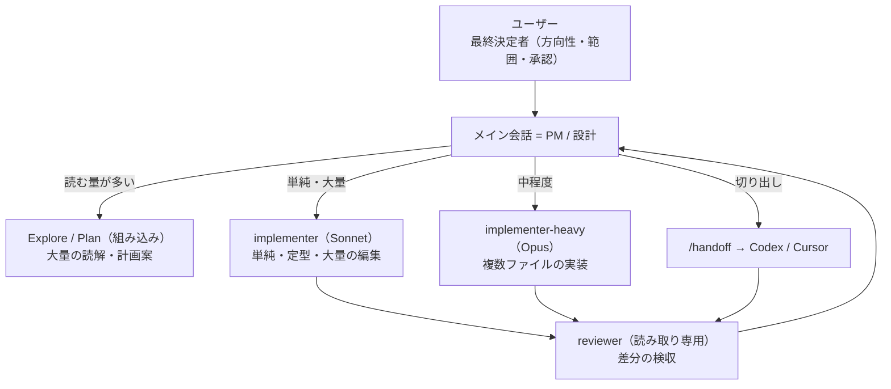

# AI-Role-Division — AI エージェントの役割分担

Claude Code で開発するときに「どの AI に、何を、どこまで任せるか」をまとめたリポジトリです。
[0x000x7f/claude-code-agent-workflow](https://github.com/0x000x7f/claude-code-agent-workflow)（MIT）の
PM ルーティングを土台に、Unity（unity-cli）＋ Spec Kit のプロジェクトで使えるよう調整しています。

> 役割分担の仕組みは**このワークフロー1つだけ**にしています。別の役割分担フレームワーク
> （例: Claude-Code-Game-Studios）を同じプロジェクトに重ねると、エージェント名・コマンド名・
> ルール・フックが重なって衝突するため、併用しません。

固定したコミットとライセンスは [SOURCES.md](SOURCES.md) と `LICENSES/` にあります。

## 全体像



## ドキュメント

| ファイル | 内容 |
|---|---|
| [ROLES.md](ROLES.md) | **役割分担表**（まずここを読む） |
| [docs/01-pm-routing.md](docs/01-pm-routing.md) | ワークフローの3原則・担当・コマンド・検収ルール |
| [docs/02-unity-practice.md](docs/02-unity-practice.md) | Unity + unity-cli + Spec Kit での実例（BallCollect） |

## テンプレート

```text
templates/
├── .claude/
│   ├── agents/      implementer.md / implementer-heavy.md / reviewer.md
│   ├── commands/    analyze-codebase.md / implement-phase.md / review-diff.md / handoff.md
│   └── rules/       agent-workflow.md
└── AGENTS.example.md   Codex / Cursor 向けの前提（Unity プロジェクトの例）
```

導入するときは、対象プロジェクトのルートへコピーし、`AGENTS.example.md` を `AGENTS.md` として書き換えます。
同じ名前のエージェント・コマンドを持つ別のフレームワークが入っていないことを先に確認してください。

```powershell
Copy-Item -Recurse .\templates\.claude\* <対象プロジェクト>\.claude\
Copy-Item .\templates\AGENTS.example.md <対象プロジェクト>\AGENTS.md
```

## License

このリポジトリ独自の文章は MIT License（[LICENSE](LICENSE)）。`templates/` は
claude-code-agent-workflow（MIT, Copyright (c) 2026 0x000x7f）を改変したものです。
