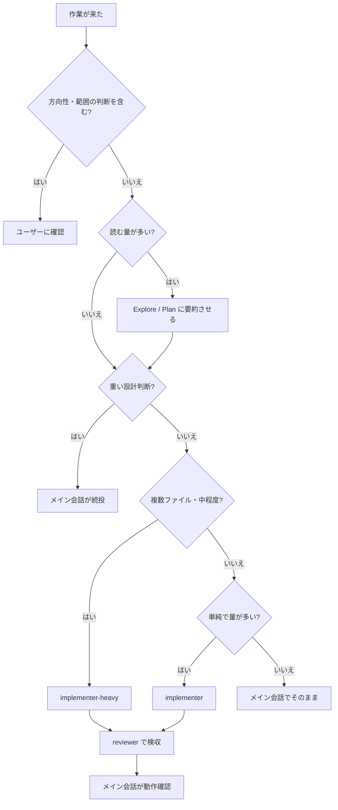

# 役割分担表

claude-code-agent-workflow の PM ルーティングを、開発の工程ごとにまとめたもの。
小規模（1人＋AI）の Unity 開発を基準にしている。

## 工程別の役割分担

| 工程 | 担当 | 成果物・手段 | 人が決めること |
|---|---|---|---|
| 方向性・範囲 | メイン会話（PM） | spec.md のユーザーストーリー、範囲外の明記 | 何を作り、何を作らないか |
| 仕様（ルール・数値） | メイン会話 | `/speckit-specify` → `/speckit-clarify` | 曖昧な点への回答 |
| 技術方針・設計 | メイン会話 ＋ Plan（読む量が多いとき） | `/speckit-plan`（research / data-model / contracts） | 方式の承認 |
| 作業分割・進行 | メイン会話 | `/speckit-tasks`、tasks.md | 範囲の追加・削除 |
| 大量の調査 | Explore | 要約だけをメイン会話へ | — |
| 実装（単純・量が多い） | implementer（Sonnet） | 定型コード、リネーム、エラー修正 | — |
| 実装（複数ファイル・中程度） | implementer-heavy（Opus） | 機能単位の実装 | — |
| 実装（重い設計判断を含む） | メイン会話が続投 | アーキテクチャ変更 | 承認 |
| エンジン操作 | 同時に1担当だけ（通常はメイン会話） | unity-cli（シーン・コンポーネント・C#） | — |
| テスト方針 | メイン会話 | quickstart.md（検証シナリオ） | 合格基準 |
| テスト実行・記録 | メイン会話（Editor 操作のため） | EditMode テスト、Play 検証、verification.md | 実際に遊んだ感想 |
| コード検収 | reviewer（読み取り専用） | approve / request changes / comment | マージの判断 |
| 外部ツールへの切り出し | `/handoff` → Codex / Cursor | HANDOFF-*.md（戻り差分は reviewer 必須） | 切り出す範囲 |

## 担当ごとの約束

| 担当 | やること | やらないこと |
|---|---|---|
| **ユーザー** | 方向性、範囲、承認、実際に遊んで判断 | — |
| **メイン会話（PM）** | 判断、振り分け、Editor 操作、検証、報告 | 小さな作業をわざわざサブエージェントに出す |
| **Explore / Plan** | 大量の読解・調査・計画案を要約して返す | 編集 |
| **implementer** | 判断が単純で量の多い編集。最小差分 | 挙動変更、設計判断、範囲外の修正 |
| **implementer-heavy** | 複数ファイルの実装と軽い設計判断（判断理由を報告） | アーキテクチャ・公開 API・スキーマの変更 |
| **reviewer** | 差分の検収（仕様・原則・テストに照らす） | コードを書く・直す、Editor を変更する操作 |
| **Codex / Cursor** | ハンドオフ文書だけを見て実装 | 文書にない前提での作業 |

## 判断フロー

## 原則

1. **人が最終決定者**。AI は提案し、ユーザーが承認する。設計判断が必要になったら推測で進めず差し戻す。
2. **文脈はファイルで共有**。仕様・計画・指示書は Markdown に残し、会話の記憶に頼らない。
3. **サブエージェントは必要なときだけ**。目的はコンテキスト汚染の防止で、細かい作業には使わない。
4. **高価なモデルは判断と検収に**。量の多い単純作業は下位モデルへ。
5. **完成は根拠で判断**。テスト結果と実際の動作確認を、確認済み・未成立・未確認に分けて記録する。
6. **役割分担の仕組みは1つだけ**。別のフレームワークを重ねない。
